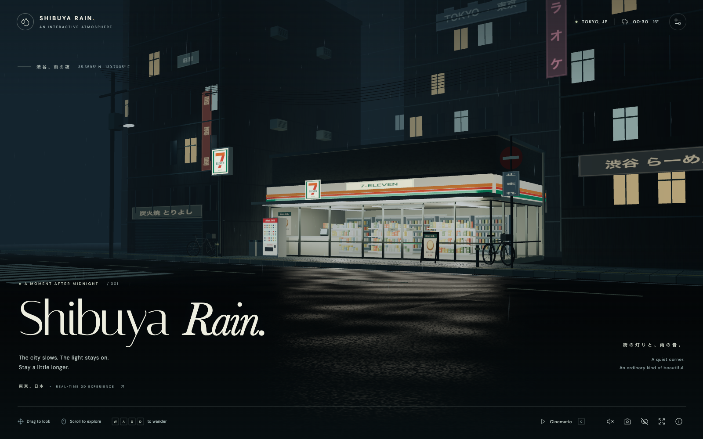
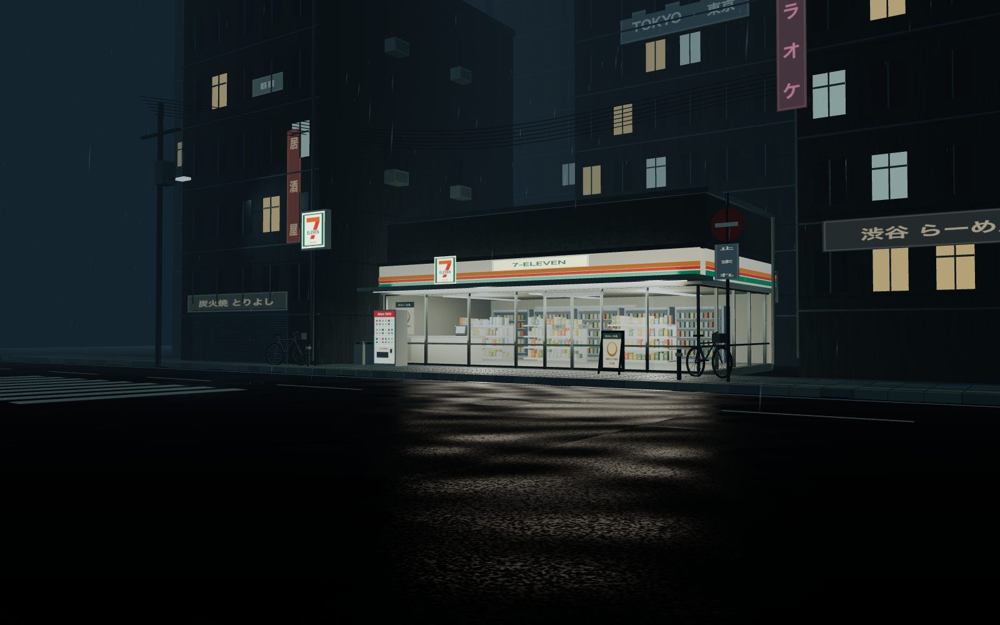

# Shibuya Rain — 雨夜涩谷

[在线体验 Shibuya Rain](https://gn3m1x.github.io/shibuya-rain/)

一个可以停留、漫游、构图和拍照的实时三维雨夜空间。以东京涩谷街角的便利店为视觉中心，采用偏冷的街道、温暖的店内灯光、低机位镜头和局部积水反射。

场景由程序化三维对象、Canvas 材质和 GLSL 天气系统组成。没有背景照片、视频、生成图片、在线模型或付费素材。字体随构建打包，运行时不需要连接素材 CDN。

## 实际场景截图

| 电影式默认界面 | 摄影模式（隐藏 UI） |
| --- | --- |
|  |  |

## 本地运行

要求：Node.js 22.12+（本次使用 Node.js 24.21.0）、npm、支持 WebGL 2 的浏览器。优先使用启用硬件加速的 macOS Chrome。

```bash
npm ci
npm run dev
```

打开终端显示的本地地址，通常为 `http://127.0.0.1:5173/`。开发服务器只监听本机。首次安装依赖需要联网；安装完成后场景、字体和音效均可本地运行。

```bash
npm run typecheck   # TypeScript 检查
npm run build       # TypeScript + Vite 生产构建，输出 dist/
npm run preview     # 本地检查生产构建，通常为 4173 端口
```

`dist/` 可以放在支持静态文件的 HTTP 服务器上。请通过 HTTP 访问，避免直接双击 `index.html` 的 file 协议。

## 操作

| 操作 | 功能 |
| --- | --- |
| 鼠标拖动 / 单指拖动 | 围绕观察目标旋转 |
| 滚轮 / 双指缩放 | 推近、拉远 |
| WASD / 方向键 | 沿街道平滑移动，相机保留当前高度 |
| C | 开关缓慢运镜 |
| R | 恢复初始机位 |
| H | 开关摄影模式，隐藏界面和画面渐变 |
| Escape | 恢复界面，关闭设置或说明 |
| P / 相机按钮 | 保存当前 WebGL 画面为 PNG，照片不包含 HTML 界面 |
| 扬声器按钮 | 主动开启 / 静音合成雨声，默认静音 |
| 右上角设置 | 雨量、夜晚 / 傍晚、画质、运镜、重置与保存 |

初始镜头高度为 1.7 m。移动速度为 2.5 m/s，带指数阻尼。建筑占地使用带安全余量的 AABB 与路径采样，防止大步长或旋转时穿墙；最低高度 1.35 m，并限制街区外边界、观察距离和旋转角度。手动移动或拖动会退出 Cinematic Mode。接近店门会触发玻璃门平滑滑动。

## 画质与自适应

| 配置 | Low | Medium（默认） | High |
| --- | --- | --- | --- |
| DPR 上限 | 1.0 | 1.35 | 1.75 |
| 满雨量雨滴上限 | 1,800 | 4,500 | 8,500 |
| 同时活动的涟漪 | 36 | 90 | 160 |
| 三维溅水粒子 | 180 | 450 | 800 |
| 真实平面反射 | 关闭 | 512 px | 1024 px |
| 水面反射近似 | 程序化柔和光斑 | 平面捕获 + 粗糙度模糊 | 更高精度平面捕获 + 模糊 |
| Bloom、细颗粒、暗角 | 关闭 | 开启 | 开启 |
| 动态方向光阴影 | 关闭 | 关闭 | 1024 px |

雨量按百分比控制 GPU 实例数量及可见度；近远雨滴具有不同长度、速度和空间遮挡。雨滴使用 GPU 位置更新，不逐帧更新成千上万个 React 组件。商品、货架、窗户、道路标线与铺装采用 InstancedMesh 批处理。

逻辑处理器数不超过 4 的设备初始选择 Low。其余设备初始选择 Medium。渲染器预热 12 秒后，如果连续三个约 2 秒的采样窗口低于 25 FPS，自动降低一级画质。隐藏标签页和恢复时的超长帧不触发降级。右上角设置可查看 FPS 和当前档位。

这里的阈值是保护措施，不是对任何设备的帧率保证。Intel MacBook 建议从 Low 或 Medium 开始。高分辨率窗口、多个同时渲染的标签页、录屏和节能模式均会影响性能。High 的平面反射会增加一次场景渲染；没有启用 SSR 或实时路径追踪。

## 模块结构

```text
src/
  App.tsx                  界面、设置、快捷键、截图、音效生命周期
  audio.ts                 本地 Web Audio 合成雨声
  config.ts                画质预算、初始机位、建筑碰撞范围
  styles.css               全屏界面、设置面板、响应式排版
  scene/
    Scene.tsx              光照、雾、ACES、后处理、性能采样
    ConvenienceStore.tsx   建筑结构、室内、商品、冷柜、自动门、店外设施
    Neighborhood.tsx       多层建筑、日文招牌、自行车、电杆、电线、空调
    Street.tsx             柏油、湿地反射、路缘石、铺装、标线、排水与井盖
    Weather.tsx            GPU 雨滴、雨棚滴水、涟漪、三维溅水、玻璃水痕
    CameraRig.tsx          轨道控制、WASD、阻尼、碰撞、恢复与运镜
    Primitives.tsx         共享盒体、实例批次、招牌、管线
    materials.ts           可重复随机数、程序化纹理、招牌与字体绘制
scripts/
  browser-smoke.cjs         Chrome 交互检查脚本
  run-browser-smoke.mjs     Playwright CLI 运行入口
```

新增建筑时同步更新 `config.ts` 的碰撞范围；新增重复对象时尽量复用 `Batch`。天气参数与画质预算集中管理。程序化纹理使用固定随机种子，便于不同版本间对比截图。

## 视觉取舍与边界

- 这是根据东京街区特征创作的环境，不是涩谷某家店铺的测绘复原。界面时间、温度和坐标均为艺术场景设定，不是实时观测。
- 路面采用一次真实平面捕获、粗糙度模糊和薄水层反射混合；Low 使用便宜的光反射近似。没有模拟水体流动、光线的多次反弹或全场景 SSR。
- 雨、涟漪、溅水和水痕是独立 GPU 视觉近似。建筑屋顶会屏蔽便利店内部雨滴，尚未对整个街区实现逐建筑雨滴碰撞。
- 玻璃采用透明 PBR 材质和轻微水痕，不进行昂贵的多层折射。窗外可以观察完整室内空间；本版本相机的活动范围以街道为主，店铺占地设有碰撞。
- 建筑和商品优先满足比例、空间层次与灯光氛围，属于程序化环境建模，未使用照片扫描资产。模型细节与真实摄影仍有差距。
- 当前仅实现相机与天气交互，没有行人 AI、车辆交通或可操作商品。

## 浏览器检查

检查采用 Playwright CLI，独立于生产依赖。先启动开发服务器，然后运行：

```bash
npx --yes --package @playwright/cli playwright-cli -s=shibuya-qa open http://127.0.0.1:5173/ --browser chrome
node scripts/run-browser-smoke.mjs
```

检查输出到 `output/playwright/`，包括原始浏览器截图、PNG 导出、逐项结果和错误记录。这个目录默认不加入 Git。

检查覆盖画质切换、雨量端点、时间切换、运镜、重置、鼠标旋转、滚轮、WASD 与店铺碰撞、摄影模式、PNG 下载、声音开关和 390 px 窄屏设置面板。测试需要已安装的 Google Chrome。结果以当次实际运行输出为准；未执行的检查不能视为通过。

## 技术与素材来源

- Vite、React、TypeScript、Three.js、React Three Fiber、Drei、React Three Postprocessing。
- UI 图标来自 `lucide-react`，ISC 许可。
- DM Sans 与 Italiana 来自 Fontsource，SIL Open Font License 1.1；字体文件本地打包。
- 建筑、商品、街道、雨和招牌纹理由本项目代码程序化生成。7-Eleven 名称、标识与配色用于此场景的视觉表达，并非官方项目。
- API 实现参考：[React Three Fiber 官方文档](https://r3f.docs.pmnd.rs/getting-started/introduction)、[Drei MeshReflectorMaterial 官方文档](https://drei.docs.pmnd.rs/shaders/mesh-reflector-material)。

依赖版本通过 `package-lock.json` 固定。字体许可原文可见 `THIRD_PARTY_NOTICES.md`。
